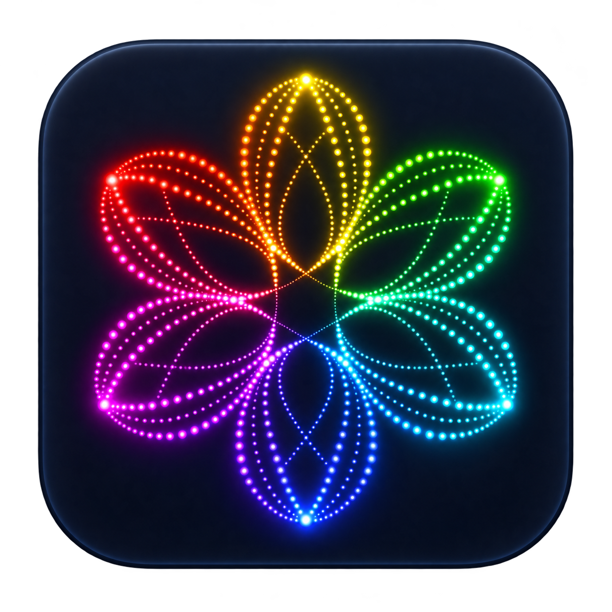

# ARose ScreenSaver

**English** | [Česky](README.cs.md)

A native recreation of the Amiga BlitzBlank ARose screen saver, with an optional modern rendering mode. Built with Swift/AppKit on macOS and C++/Win32/Direct2D on Windows; no emulator, network access, or account required.

<p align="center"></p>

## Features

- **Original Amiga:** indexed colors, crisp bitmap points and the reconstructed animation sequence.
- **Modern:** smooth points at the display’s resolution, a continuous rainbow palette and adjustable glow.
- New installations default to **Modern, 80% glow and a long trail**. Updates preserve saved settings.
- English and Czech UI, selected from macOS language preferences; English fallback.
- A drag-installed `ARose.app` with an embedded screen saver extension, plus a standalone `.saver` for older systems. All Mac variants share the renderer and settings UI.

## Availability

This repository is being prepared for its first public release. No public download is announced yet.

| Platform | Status | Intended download |
| --- | --- | --- |
| macOS | Implemented; public distribution preparation in progress | Universal drag-to-Applications DMG; separate standalone `.saver.zip` |
| Windows | Initial x64 port; runtime acceptance pending | Native `.scr` in a ZIP with installation instructions |

The app and standalone `.saver` target macOS 13 or later; the embedded `.appex` targets macOS 14 or later and uses private ScreenSaver APIs. Both Apple Silicon and Intel architectures are built; manual validation has been performed on a Mac M2. Intel hardware and the full supported OS range have not been tested.

Future GitHub Releases can carry downloads for both platforms under one version. Development artifacts are **ad-hoc signed, not notarized** and are not a finished public installer. See the [release guide](docs/releases.md) for the outstanding distribution requirements.

## Build and run

Install Xcode and select its command-line tools, then run from the repository root:

```sh
./script/build_and_run.sh          # Build and launch the preview
./script/build_and_run.sh --build  # Build only
./script/test.sh                   # Run after building
./script/package_candidate.sh      # Package a local development candidate
./script/package_macos_installer.sh # Create the drag-to-Applications DMG
```

Build logs are in `.build/build.log`. Clean installation archives are in `dist/`. Use the ZIPs rather than re-zipping loose bundles: managed Documents folders can add Finder metadata that invalidates signatures.

## Windows build and installation

The native Windows build can be built and tested with `./script/build_windows.ps1`.
Modern mode uses batched Direct3D 11 GPU drawing, with Direct2D fallback; the CPU
debug overlay identifies the renderer. See [Windows performance notes](docs/windows-performance.md)
for repeatable comparisons and measured image differences.

See the [release guide](docs/releases.md) for Visual Studio/CMake build commands.
The Windows port includes `/s` full-screen mode, `/c` settings, `/p` embedded
system preview and `/w` an interactive window. The default style, glow and trail
match macOS. The Direct2D glow renderer is visually similar, not pixel-identical
to the Mac renderer. Settings follow Windows UI language preferences.

Extract the Windows ZIP into a permanent user folder, then right-click
`ARose.scr` → **Show more options** → **Install** to open Windows screen saver
settings. The current candidate is unsigned and has not yet passed manual
Windows acceptance. See [Windows installation notes](Windows/INSTALL.txt).

## Local macOS installation

1. Open the DMG in `dist/releases/` and drag **ARose** onto **Applications**.
2. Open `/Applications/ARose.app` once, then choose **Screen Saver Settings…** in its menu and select ARose in System Settings. After replacing an existing app, open the installed copy once. It automatically refreshes the screen saver host and reopens System Settings if it was running.
3. The screen saver extension stays inside the app. The app does not copy a `.saver` into your Library and does not need to remain open.
4. On macOS 13, or to use the classic format independently, extract `dist/ARose.saver.zip` and open `ARose.saver` in Finder. The classic and extension versions have separate preferences; installing both is optional.

These locally signed builds may be blocked when transferred to another computer. A notarized public distribution is still pending; this project does not disable macOS security protections.

Preview shortcuts: **⌘ ,** settings, **⌘ F** full screen, **⌘ P** pause, **⌘ R** restart, **⌘ N** advance ten simulation seconds, **⌘ Q** quit.

## Known limitations

- The companion app and system screen saver have independent settings and saved figures on both platforms. Configure the saver through the system's Options/Settings button; experimenting in the app does not change it.
- The classic `.saver` can still suffer from the legacy host's Options dialog failure after closing and reopening the picker. The app's `.appex` uses a dedicated configuration controller and avoids that legacy presentation path. Repeated picker close/reopen and Save/Cancel were verified locally on macOS 27.0.1; this is not acceptance of every macOS version.
- The extension API is private and may change in future macOS releases. macOS 14–26 and Intel runtime acceptance remain pending. See [extension implementation and validation](docs/macos-extension.md).
- No frame-by-frame equivalence with physical or emulated Amiga hardware has been measured. Original saved-animation state is not implemented.

Tests exercise 600,000 simulation frames, settings validation, localization, actual saver-bundle loading, resizing and glow behavior. They do not replace manual testing inside System Settings or long-running performance checks.

## Origins and license

Original ARose by **Wolfgang Breyha and Michael Matzl, 1994–1995**. Its documentation credits Rose from After Dark as inspiration. The recreation uses control sequences transcribed from `BB.ARose020881`, internal version 1.2 (05 April 1995), distributed in `ARoseBlitz1.1`. Original binaries are not included. [Reconstruction notes (Czech)](docs/reconstruction.md) document the process and limitations.

New contributions are offered under [MIT](LICENSE), **only to the extent of rights held by their contributors**. This does not relicense the original control data or grant rights in derived material. See [third-party notices](THIRD_PARTY_NOTICES.md). Clarifying those rights remains a prerequisite for public distribution of the complete project.

## CPU debug overlay

Enable **Debug: show process CPU usage** in settings on either platform.
The bottom-right overlay samples once per second and is off by default.
Two values appear side by side: **1 core** uses 100% for one logical core and
can exceed 100%; **All cores** uses 100% for all logical cores combined.
For example, 300% and 75% represent the same process CPU time on four cores.
Performance and efficiency cores count equally: this measures CPU time, not
weighted computational throughput.
This measures process CPU time, not system load or GPU activity. On macOS it
includes the whole saver host process, potentially serving several views.
A dash is shown before the first measurement. Update both the Mac saver and
preview app, then reopen System Settings to load the new preference schema.

Modern mode renders both glow and sharp points through Metal on supported Macs, including when glow is off. A small precomputed coverage texture preserves Core Graphics antialiasing of fine points. Unavailable Metal falls back to CPU rendering. Image differences and benchmark limits are documented in [performance notes](docs/performance.md).

Windows GPU measurements and remaining native runtime checks are recorded in the [Windows continuation guide](docs/windows-handoff.md) and [performance notes](docs/windows-performance.md).

## Resume from last figure

When continuation is off, each new full-screen saver session starts from the
beginning, including when macOS reuses the same view. Repeated starts of an
active animation do not reset the figure. Views flagged as previews by macOS
also keep their progress across temporary stops.

Enable **Resume from last figure** to continue the pattern, rotation and color
phase on the next run, including after restarting the computer. This option is
off by default and works in both styles. State is saved on normal exit. macOS also checkpoints the first frame and every
second because its legacy host may omit the exit callback; Windows checkpoints
every 30 seconds. A forced termination can lose the latest interval.
Trails rebuild over the first 0.4 seconds rather than being stored as an image.
Previews reported as previews by the OS never update the saved position. Some
macOS versions run the System Settings thumbnail as a full saver; in that case
it shares the system saver bookmark. The standalone
macOS preview and Windows `/w` window keep their own separate position. Disabling
the option ignores the bookmark without deleting it. Invalid or unsupported
saved states are ignored. No files are sent over the network.

To start over, click **Forget saved figure**, then **Save**. This clears both
the saver and standalone preview bookmarks without changing the resume option.
**Cancel** preserves the original position.

On macOS 14 and later, Modern animation follows the display refresh rate,
including 120 Hz, and interpolates positions and colors between the unchanged
50 Hz simulation steps. Original Amiga mode and older macOS retain PAL pacing.
The system may lower the actual refresh rate under power or display constraints.

On macOS and Windows, Original Amiga mode renders at the drawable's physical
pixel resolution, including Retina and high-DPI displays. Like Modern mode,
the default-enabled “Scale retro figures to display resolution” option scales
figure coordinates uniformly by the shorter pixel dimension divided by 640,
while retro dots remain single pixels. Disable it to keep a fixed pixel size,
as on the Amiga; resolution-based enlargement was introduced by WinRose. Original integer quantization, palettes
and trail erasure are retained. The initial simulation target radius is 150,
independent of the display; resizing preserves the figure and clears its trail.
Windows keeps a separate raster for each monitor without stretching the bitmap.

## Installation and updates

The release tooling now prepares a per-user macOS DMG installer and a Windows
installer, plus independent `.saver.zip` / `.scr` downloads. Companion apps offer
manual checking and optional weekly checking (off by default). After confirmation,
updates download, verify and install through Sparkle / WinSparkle. Standalone
savers need no updater or additional runtime. Public downloads are not live yet.
See [installation and update details](docs/updates.md).
