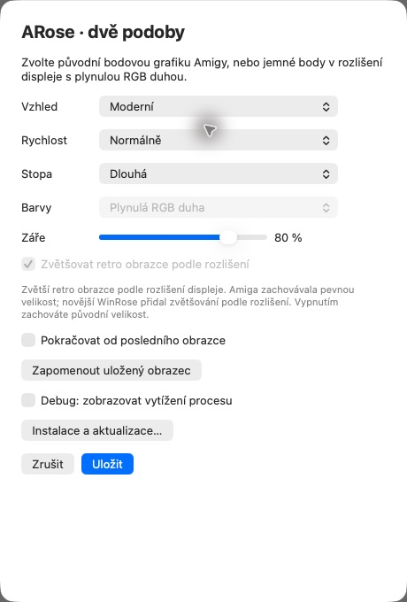
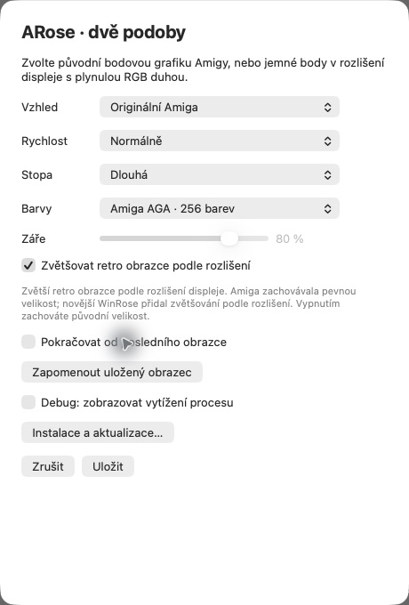

# Uživatelský průvodce ARose

[English](guide.md) | **Česky** · [Zpět na hlavní stránku](../README.cs.md)

## Požadavky a stav vydání

První veřejné vydání se připravuje. Veřejná kontrola aktualizací bude použitelná po zveřejnění vydání a jeho aktualizačních souborů.

| Platforma | Požadavek | Stav ověření |
| --- | --- | --- |
| macOS | macOS 14+ pro aplikaci se systémovým spořičem; Apple Silicon nebo Intel | Ručně ověřováno na Macu M2. Další verze macOS a Intel zatím čekají na provozní ověření. |
| Windows | Windows 11 x64 | Nativní sestavení a dílčí testy proběhly; závěrečný uživatelský test před prvním vydáním zbývá. |

Současné vývojové balíčky pro Mac mají pouze místní podpis a Windows sestavení nemají distribuční podpis. Podpis Developer ID a notarizace macOS balíčku patří do přípravy veřejného vydání. Samotné úspěšné sestavení nepotvrzuje vyzkoušení na všech systémech.

## Instalace

### Mac

1. Otevřete instalační DMG a přetáhněte ARose na Aplikace.
2. Spusťte nainstalovanou aplikaci jednou ze složky Aplikace.
3. V nabídce **ARose → Nastavení systémového spořiče…** vyberte ARose a otevřete **Volby…**.

Umístění spořičů v Nastavení systému se liší podle verze macOS; na novějších verzích je najdete v části Tapeta. Aplikace může po výměně nebo aktualizaci obnovit otevřené Nastavení systému, aby se načetl nový spořič. Aplikaci poté můžete zavřít.

Klasický `.saver` není součástí plánovaných veřejných souborů ke stažení. Pokud jej máte ze starších vývojových testů, jde o nezávislou instalaci; přetažení nové aplikace jej neodstraní.

### Windows

Spusťte instalační `Setup.exe`, potvrďte správce a dokončete průvodce. V nabídce Start najdete **ARose** s ovládacími prvky a **ARose Preview** s animací v okně. V systémovém nastavení spořičů zvolte ARose. Instalátor ani spořič nepřebírají správu hesla, zamykání nebo doby nečinnosti — tyto volby dál spravují Windows.

### Samostatný spořič pro Windows

Samostatný `ARose.scr` nevyžaduje aplikaci ani další frameworky. Uložte jej do trvalé složky, klikněte na něj pravým tlačítkem a zvolte **Nainstalovat** (případně nejprve **Zobrazit další možnosti**). Tím otevřete systémové nastavení spořičů, kde vyberete ARose.

Dokud je soubor vybraný jako spořič, nepřesouvejte jej. Novou verzi pak instalujete ruční výměnou souboru. Pro pohodlné aktualizace použijte plný instalátor.

## Kde měnit nastavení

**Aplikace a systémový spořič mají vlastní oddělené volby i uloženou pozici.**

- Pro systémový spořič použijte **Volby…** v macOS nebo **Nastavení** v systémovém dialogu Windows.
- V aplikaci macOS otevřete tlačítko **Nastavení…**. Ve Windows otevřete náhled a stiskněte **F1**.
- Změny potvrďte tlačítkem **Uložit**. **Zrušit** je zahodí.

Následující snímky pocházejí ze skutečného nastavení aplikace na macOS. Stejné volby jsou dostupné také pro systémový spořič; jeho nastavení se ukládá samostatně.

## Co jednotlivé volby dělají

| Volba | Význam |
| --- | --- |
| Vzhled | **Originální Amiga** pro retro body a palety, **Moderní** pro jemné body a plynulou duhu. |
| Rychlost | Mění tempo proměn a pohybu. |
| Stopa | Určuje, jak dlouhá historie bodů zůstává viditelná. |
| Barvy | V Retro režimu vybírá černobílou, ECS nebo AGA paletu. Moderní režim používá plynulou RGB duhu. |
| Záře | V Moderním režimu nastavuje světlo kolem bodů od 0 do 100 %. Při nule zůstávají jemné body bez záře. |
| Zvětšovat retro obrazce podle rozlišení | Zvětší obrazce pro dnešní displeje, ale body ponechá ostré. Vypnutím získáte pevnou pixelovou velikost jako na Amize. Zvětšování podle rozlišení přinesl pozdější WinRose. |
| Pokračovat od posledního obrazce | Při dalším spuštění naváže přibližně na předchozí pozici. Ve výchozím stavu je vypnuté. |
| Zapomenout uložený obrazec | Po potvrzení tlačítkem Uložit smaže pozici v právě nastavované aplikaci či spořiči. Volbu pokračování nevypíná. |
| Debug: zobrazovat vytížení procesu | Volitelný technický údaj o CPU; pro běžné používání jej můžete ponechat vypnutý. |

Pokračování obnovuje obrazec, natočení a barevnou fázi, nikoli uložený obrázek. Stopa se po spuštění znovu dokreslí. Vypnutí pokračování pozici nemaže; k resetu použijte **Zapomenout uložený obrazec → Uložit**. Změna vzhledu může animaci restartovat.

## Aplikace pro hraní s obrazci

| Akce | macOS | Náhled Windows |
| --- | --- | --- |
| Nastavení | Tlačítko Nastavení… nebo ⌘ , | F1 |
| Celá obrazovka | ⌘ F | F |
| Pozastavit / pokračovat | ⌘ P | Mezerník |
| Začít znovu | ⌘ R | R |
| Posunout animaci dopředu | ⌘ N | — |
| Ukončit | ⌘ Q | Esc; z celé obrazovky nejprve vrátí okno |

## Aktualizace

V nainstalované aplikaci zvolte **Zkontrolovat aktualizace…**. Pokud je nová verze dostupná, aktualizační okno vás provede stažením a instalací. Windows mohou vyžádat potvrzení správce. Aktualizace aplikace na Macu obsahuje i systémový spořič.

Volbu **Automaticky kontrolovat jednou týdně** lze zapnout dobrovolně; zpočátku je vypnutá. Kontrola počítač neprobouzí a její provedení se může odložit, například když je zařízení zamknuté nebo spí. Animace nepotřebuje internet, nevyžaduje účet a neposílá telemetrii.

## Odinstalace

**Mac:** vypněte týdenní kontrolu, je-li zapnutá, vyberte jiný systémový spořič a přesuňte **ARose.app** z Aplikací do koše. Vložený spořič je součástí aplikace. Případný starý samostatný `.saver` se odstraňuje zvlášť ze složky `Library/Screen Savers`.

**Windows instalátor:** použijte odinstalaci aplikace ve Windows. Na sdíleném počítači by si i ostatní uživatelé měli nejprve vybrat jiný spořič.

**Samostatný Windows soubor:** vyberte jiný spořič nebo Žádný a potom smažte `ARose.scr`.

Uložené preference a obrazce zůstanou zachované pro případ nové instalace.

## Když něco nefunguje

- Po ruční výměně na Macu nejprve jednou spusťte novou aplikaci ze složky Aplikace.
- Změna v aplikaci se nepromítla do spořiče? Jejich nastavení jsou záměrně oddělená; otevřete systémové Volby.
- Kontrola aktualizací ve vývojovém sestavení může selhat, dokud není zveřejněný aktualizační kanál.
- Pro hlášení chyby použijte [GitHub Issues](https://github.com/CooLajz/ARose-ScreenSaver/issues). Uveďte systém a jeho verzi, verzi ARose, zvolený režim a postup, jak problém zopakovat. Snímek obrazovky pomůže; osobní údaje před odesláním zakryjte.
